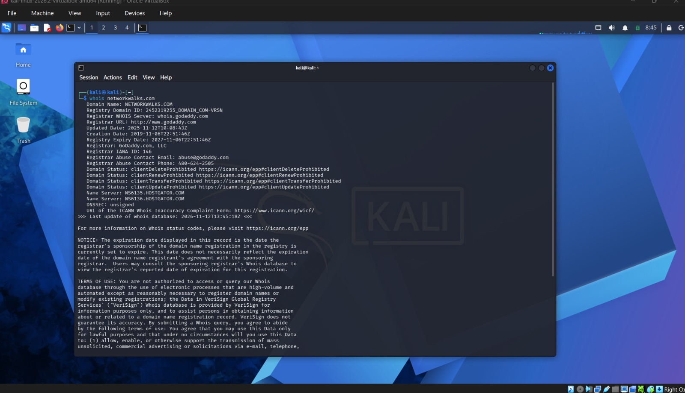
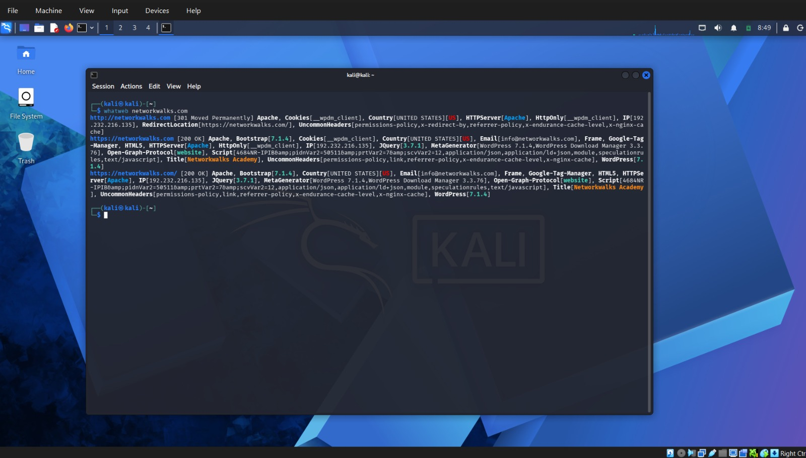
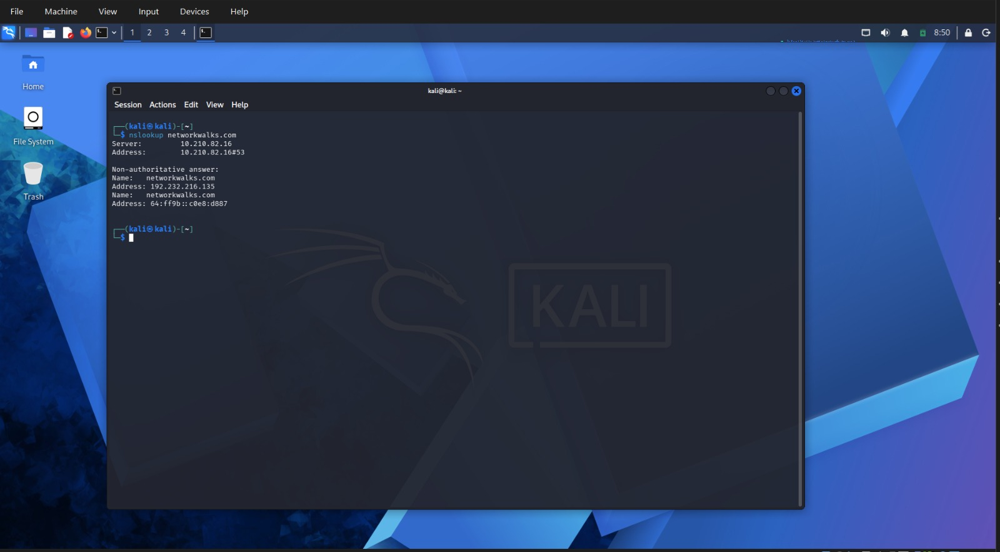
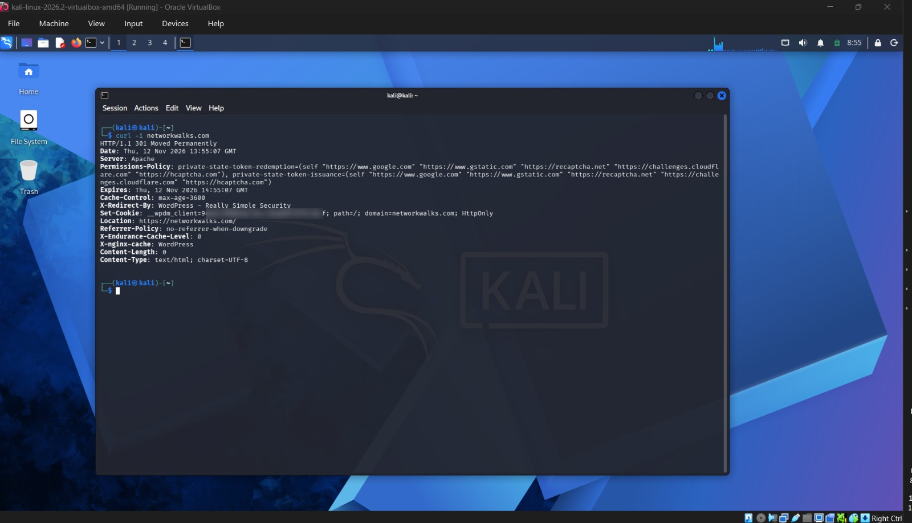
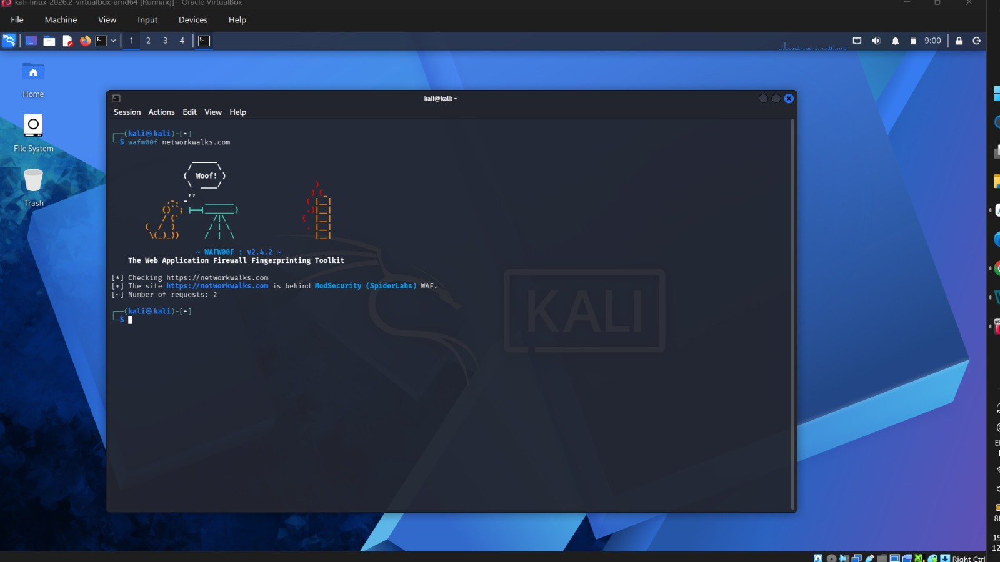
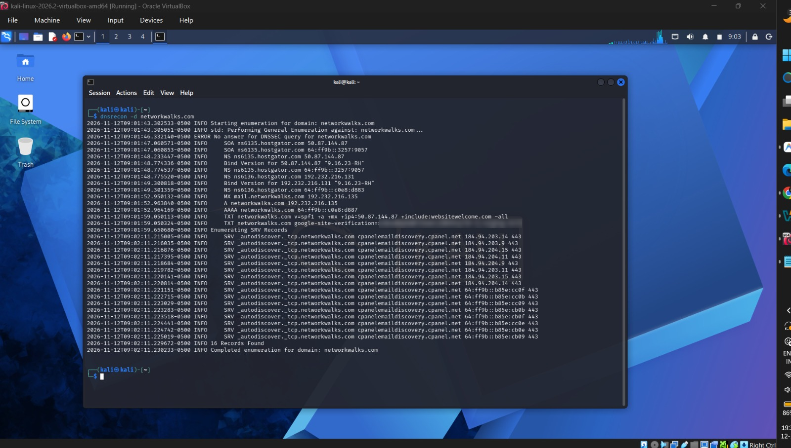
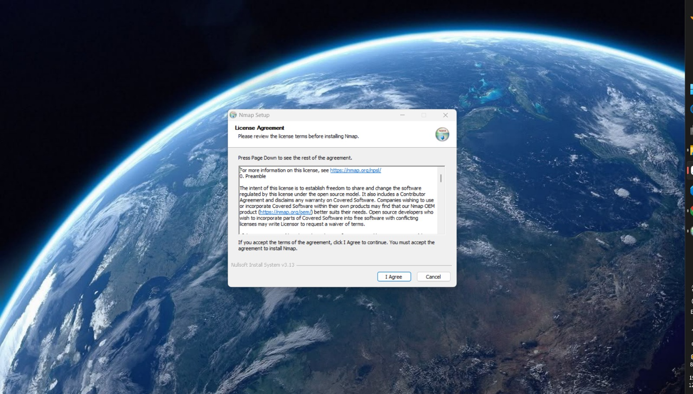
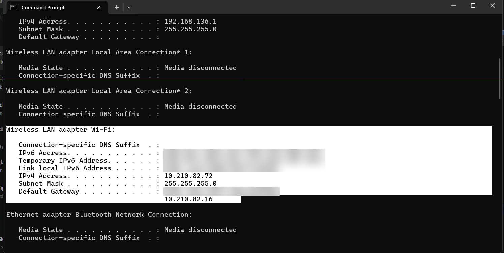
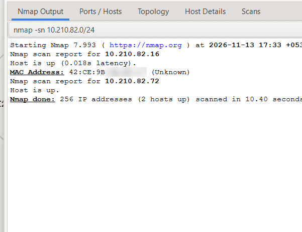
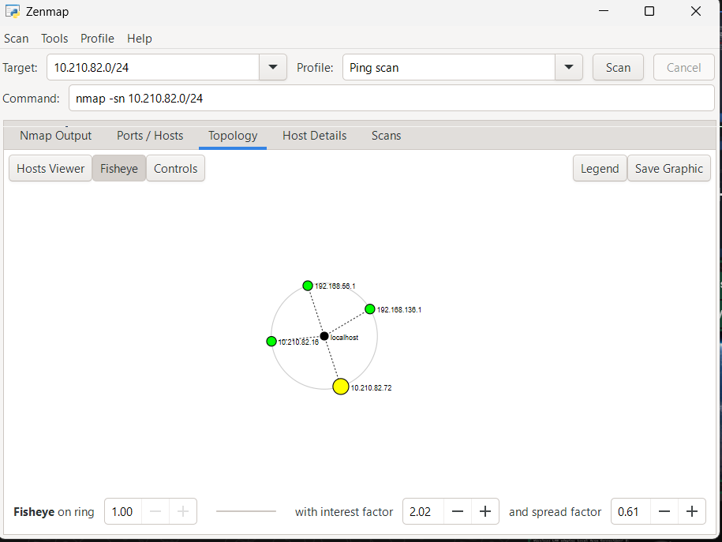

# PENETRATION TESTING REPORT
### Footprinting & Network Scanning Phases

**W2-PM1 + W2-PM5 | CYBERSECURITY & ETHICAL HACKING**

| Field | Detail |
|---|---|
| **Pentester Name** | VYOM KUSHVAHA |
| **Program/Batch** | Internship program by Networkwalks (B-084 Batch) |
| **Dates** | 12 November 2026 (W2-PM1 footprinting); 13 November 2026 (W2-PM5 scanning) |
| **Modules completed** | W2-PM1 (Footprinting with multiple Kali tools) W2-PM5 (Network scanning with Zenmap) |
| **Client/Target** | 1. networkwalks.com (public lab target of the module) 2. My own local LAN, subnet 10.210.82.0/24 |
| **Permission status** | Targets are the module’s lab scope; no separate permission letter was supplied with these materials |
| **Phases covered** | Phase 1: Reconnaissance & Footprinting Phase 2: Scanning & Network Discovery |

---

# 1. Liability Disclaimer

I performed these activities only within the scope of the educational lab: the public lab target named in the module and my own local network. All material is for education and research purposes only and must not be used to break the law. The instructor, the authors and Networkwalks are not responsible for how this knowledge is used. Every action taken is the responsibility of the person performing it; unauthorised access or scanning can be a crime in many countries even when nothing is damaged.

# 2. Introduction

This report combines two Week 2 modules. W2-PM1 covers footprinting and reconnaissance of the domain networkwalks.com with six Kali Linux tools. W2-PM5 covers network scanning of my own local network with Zenmap. Together they show how a tester moves from gathering public information about a target to mapping live hosts on a network.

The footprinting commands were run in Kali Linux (a VirtualBox virtual machine). The scanning was done on a Windows PC with Zenmap (Nmap 7.993). Each step records the command used, the result I observed, a screenshot as evidence and a short note on why the finding matters from an attacker’s point of view. All results come from my own screenshots and outputs; where a required item was not available, this is stated.

*Privacy note: Session cookie values, a Google site-verification token, IPv6 addresses of my PC and the last three bytes of MAC addresses were blurred or masked (XX). Public domain information and private IPv4 addresses are retained because the tasks depend on them.*

# 3. Tools Used

The table below lists each tool used in this report and its purpose:

| Tool | Purpose |
|---|---|
| **Kali Linux (VirtualBox) & Windows 11** | Operating systems used for the footprinting and scanning activities. |
| **whois** | Find domain registration details (registrar, dates, name servers). |
| **whatweb** | Fingerprint web technologies (server, CMS, plugins, IP). |
| **nslookup** | Resolve the domain name to its IP address using DNS. |
| **curl** | Read the HTTP response headers of the website. |
| **wafw00f** | Detect whether a Web Application Firewall protects the site. |
| **dnsrecon** | Enumerate DNS records (SOA, NS, MX, A, AAAA, TXT/SPF, SRV). |
| **Zenmap / Nmap 7.993** | Scan the local subnet for live hosts, IP and MAC addresses; draw the topology. |
| **Windows Command Prompt** | `ipconfig` and `ipconfig /all` to find local IP, subnet and MAC address. |

# 4. Activities Performed

## 4.1 Footprinting & Reconnaissance (W2-PM1)

I performed reconnaissance on `networkwalks.com` using six Kali Linux tools. Each tool collects a different type of information, and together they build a profile of the target without touching it beyond ordinary public queries.

### Task 1: whois, domain registration
**Command:** `whois networkwalks.com`

*Figure 1: whois output for networkwalks.com.*

| Field | Result |
|---|---|
| **Registrar** | GoDaddy.com, LLC (IANA ID 146); WHOIS server whois.godaddy.com |
| **Created / Updated / Expires** | 2019-11-06 / 2025-11-12 / 2027-11-06 (UTC) |
| **Domain status** | clientDeleteProhibited, clientRenewProhibited, clientTransferProhibited, clientUpdateProhibited |
| **Name servers** | NS6135.HOSTGATOR.COM and NS6136.HOSTGATOR.COM |
| **DNSSEC** | unsigned |
| **Registrar abuse contact** | abuse@godaddy.com, 480-624-2505 |

The HostGator name servers show the likely hosting provider, and the registrar and dates give context useful for planning or social engineering. The transfer, update and delete locks are a good protection against domain hijacking. No registrant personal details appear in the visible output.

### Task 2: whatweb, web technology fingerprint
**Command:** `whatweb networkwalks.com`

*Figure 2: whatweb output for networkwalks.com.*

| Item | Result |
|---|---|
| **HTTP behaviour** | `http://networkwalks.com` returns 301 Moved Permanently to `https://networkwalks.com/`, which returns 200 OK |
| **Web server** | Apache |
| **CMS / plugin** | WordPress 7.1.4 and WordPress Download Manager 3.3.76 (from the MetaGenerator tag) |
| **Other technologies** | jQuery 3.7.1, Bootstrap, HTML5, Google Tag Manager, Open Graph Protocol |
| **Server IP / country** | 192.232.216.135 / United States |
| **Page title** | Networkwalks Academy |
| **Public e-mail address** | info@networkwalks.com |
| **Cookie** | `__wpdm_client` (HttpOnly) |
| **Uncommon headers** | permissions-policy, link, referrer-policy, x-endurance-cache-level, x-nginx-cache |

Exact software versions let an attacker search vulnerability databases for matching issues. The version numbers also differ from those printed in the lab handout, so the values above are the ones I actually observed.

### Task 3: nslookup, DNS resolution
**Command:** `nslookup networkwalks.com`

*Figure 3: nslookup output for networkwalks.com.*

The query was answered by my local DNS server `10.210.82.16` (port 53), the same device identified as my gateway in W2-PM5. The answer was non-authoritative: IPv4 `192.232.216.135` and an IPv6 address `64:ff9b::c0e8:d887`. The hex part `c0e8:d887` equals `192.232.216.135`, and the `64:ff9b::/96` prefix is the standard NAT64 prefix, so the IPv6 answer appears to be synthesised from the IPv4 address by my network’s DNS64 service. This is an inference from the address format.

### Task 4: curl, HTTP response headers
**Command run:** `curl -i networkwalks.com`

The module specifies `curl -I https://networkwalks.com`; my screenshot shows the variant with a lowercase `i` and no `https`, so only the redirect response was captured.

*Figure 4: curl output showing the HTTP 301 response headers (cookie value blurred).*

| Header | Value / meaning |
|---|---|
| **Status** | HTTP/1.1 301 Moved Permanently; Location: `https://networkwalks.com/` |
| **Date** | Thu, 12 Nov 2026 13:55:07 GMT |
| **Server** | Apache |
| **X-Redirect-By** | WordPress - Really Simple Security (a security plugin is revealed) |
| **Cache headers** | Cache-Control max-age=3600; X-Endurance-Cache-Level: 0; X-nginx-cache: WordPress |
| **Set-Cookie** | `__wpdm_client` (value blurred); path=/; HttpOnly |
| **Referrer-Policy** | no-referrer-when-downgrade |
| **Permissions-Policy** | Allows private-state-token features for Google, gstatic, reCAPTCHA, Cloudflare challenges and hCaptcha |

Headers reveal the web server, the caching stack and the security plugin without loading a page. The WordPress REST path `/wp-json/` mentioned in the lab handout does not appear in my output, so it is not reported.

### Task 5: wafw00f, WAF detection
**Command:** `wafw00f networkwalks.com`

*Figure 5: wafw00f (v2.4.2) output for networkwalks.com.*

wafw00f checked `https://networkwalks.com` with 2 requests and reported that the site is behind **ModSecurity (SpiderLabs) WAF**. For an attacker this means simple attack attempts would likely be blocked or logged, so a different approach would be needed.

### Task 6: dnsrecon, DNS enumeration
**Command:** `dnsrecon -d networkwalks.com`

*Figure 6: dnsrecon output for networkwalks.com (token blurred).*

| Type | Result |
|---|---|
| **SOA** | ns6135.hostgator.com (50.87.144.87) |
| **NS** | ns6135.hostgator.com (50.87.144.87); ns6136.hostgator.com (192.232.216.131) |
| **BIND version** | "9.16.23-RH" disclosed by both name servers |
| **MX** | mail.networkwalks.com (192.232.216.135) |
| **A / AAAA** | 192.232.216.135 / 64:ff9b::c0e8:d887 |
| **TXT (SPF)** | `v=spf1 +a +mx +ip4:50.87.144.87 +include:websitewelcome.com ~all` |
| **TXT (other)** | google-site-verification record (token blurred) |
| **SRV** | `_autodiscover._tcp` pointing to cpanelemaildiscovery.cpanel.net on port 443 (8 IPv4 and 8 IPv6 entries) |
| **DNSSEC** | No answer for DNSSEC query (consistent with "unsigned" in whois) |
| **Total** | 16 records found; enumeration completed |

The records expose the hosting provider, mail server, the allowed mail senders and the name-server software version. The SPF record ends in `~all` (soft fail), which is more permissive than a strict `-all` policy.

---

## 4.2 Network Scanning with Zenmap (W2-PM5)

For the second activity I used Zenmap on my local network. The tasks were: install Zenmap, find my IP and subnet, discover live hosts, count them, list their IP and MAC addresses and save the topology as a PDF.

### Task 1: Download & install Zenmap
The task directs the download to the official site (`https://nmap.org/download.html`).

*Figure 7: Nmap Setup, License Agreement page.*

Figure 7 shows the Nmap Setup License Agreement page (Nullsoft Install System v3.13), which must be accepted with *I Agree*. The version seen in the scan output is 7.993.

*Not available: screenshots of the other installer pages and of Zenmap’s first launch were not supplied. Zenmap ran successfully in later tasks, confirming the installation.*

### Task 2: Local IP address & LAN subnet
I ran `ipconfig` and `ipconfig /all` in Command Prompt. The active connection is the Wi-Fi adapter.

*Figure 8: ipconfig output for the Wi-Fi adapter (IPv6 addresses blurred).*

| Item | Value |
|---|---|
| **Adapter** | Wireless LAN adapter Wi-Fi (Intel(R) Wi-Fi 6 AX201 160MHz) |
| **Local IPv4 address** | 10.210.82.72 |
| **Subnet mask** | 255.255.255.0 (/24) |
| **LAN subnet** | 10.210.82.0/24 (usable 10.210.82.1 to 10.210.82.254; broadcast 10.210.82.255) |
| **Default gateway (IPv4)** | 10.210.82.16 |
| **DHCP server / DNS server (IPv4)** | 10.210.82.16 |
| **DHCP lease** | Obtained 13 November 2026 15:39:35; expires 13 November 2026 17:09:44 |
| **IPv6 addresses / gateway** | Present; redacted for privacy |

With a `/24` mask the first three octets (`10.210.82`) identify the network, so the scan range is `10.210.82.0/24` with 256 addresses. `ipconfig` also lists two VirtualBox Host-Only adapters (`192.168.56.1/24` and `192.168.136.1/24`); these are virtual interfaces on my PC, not part of the Wi-Fi LAN. The Ethernet, Bluetooth and Wi-Fi Direct adapters showed *Media disconnected*.

### Task 3: Find the live hosts in the subnet
In Zenmap I entered `10.210.82.0/24` as the target with the *Ping scan* profile, which runs `nmap -sn 10.210.82.0/24`. A ping scan checks which addresses respond but does not scan ports.

*Figure 9: Zenmap Nmap Output for the ping scan (MAC address partly blurred).*

| Scan detail | Result |
|---|---|
| **Command** | `nmap -sn 10.210.82.0/24` |
| **Nmap version** | 7.993 |
| **Scan start** | 2026-11-13 17:33 (time zone offset cut off in the screenshot) |
| **Addresses scanned / hosts up** | 256 / 2 |
| **Scan duration** | 10.40 seconds |

### Task 4: How many hosts are live?
**Answer:** **2 hosts are live** (including my own PC). Nmap reported *"256 IP addresses (2 hosts up) scanned in 10.40 seconds"*. The other 254 addresses did not respond. Possible reasons are unused addresses, devices that block discovery probes, or Wi-Fi client isolation; the output does not show which applies.

### Task 5: IP addresses of the live hosts
| # | IP address | Role / evidence |
|---|---|---|
| **1** | `10.210.82.16` | Responded to the scan (latency 0.018 s); same address as my default gateway, DHCP server and DNS server. |
| **2** | `10.210.82.72` | My own PC (Wi-Fi adapter); shown as "Host is up" without latency or MAC because it is the scanning machine. |

### Task 6: MAC addresses of the live hosts
Nmap reads the MAC addresses of other hosts on the subnet through ARP. It does not print the scanning machine’s own MAC, which comes from `ipconfig /all`. The last three bytes are masked for privacy.

| IP address | MAC address (masked) | Source / note |
|---|---|---|
| `10.210.82.16` | `42:CE:9B:XX:XX:XX` | Nmap scan output; vendor shown as "(Unknown)". |
| `10.210.82.72` | `7C-50-79-XX-XX-XX` | `ipconfig /all`, Physical Address of my Wi-Fi adapter. |

Nmap could not map the gateway’s prefix (`42:CE:9B`) to a vendor. The first byte `0x42` has the "locally administered" bit set, which commonly indicates a software-assigned or randomised MAC rather than a manufacturer-assigned one. This is an inference from the address format, not a confirmed fact.

### Task 7: Display & save the network topology
I opened the *Topology* tab (*Fisheye* view) after the scan.

*Figure 10: Zenmap Topology tab, Fisheye view, after the ping scan.*

| Node | Interpretation |
|---|---|
| **localhost** (black, centre) | My own PC, the scanning host. |
| **10.210.82.16** (green) | Live host on the Wi-Fi LAN: my gateway / DHCP / DNS server. |
| **10.210.82.72** (yellow, larger) | My PC’s Wi-Fi address, drawn as a separate, larger node. |
| **192.168.56.1, 192.168.136.1** (green) | My PC’s two VirtualBox Host-Only adapters from ipconfig; local virtual interfaces, not devices found on 10.210.82.0/24. |

Every node connects directly to `localhost` with no intermediate routers, giving a flat single-hop view. Node colours and sizes are defined by the Zenmap Legend, which was not open in my screenshot, so I do not interpret them further. A ping scan collects no open-port data, so colours should not be read as port results.

*Not available: the topology PDF (Topology > Save Graphic > PDF) was not among the supplied files, so it cannot be included or described. Figure 10 is the only topology evidence here; the PDF should be exported and attached with this report, with any sensitive values blurred.*

---

# 5. Summary of Results

| Module / Task | Requirement | Result |
|---|---|---|
| **PM1 / 1** | whois | GoDaddy registrar; created 2019-11-06; expires 2027-11-06; HostGator name servers |
| **PM1 / 2** | whatweb | Apache; WordPress 7.1.4; WP Download Manager 3.3.76; IP 192.232.216.135 |
| **PM1 / 3** | nslookup | 192.232.216.135 (and NAT64-style IPv6 64:ff9b::c0e8:d887) |
| **PM1 / 4** | curl headers | 301 redirect to HTTPS; Apache; Really Simple Security; cookie set |
| **PM1 / 5** | wafw00f | ModSecurity (SpiderLabs) WAF detected |
| **PM1 / 6** | dnsrecon | 16 records; BIND 9.16.23-RH; SPF ~all; MX mail.networkwalks.com |
| **PM5 / 1** | Install Zenmap | Nmap/Zenmap 7.993; license page evidence only |
| **PM5 / 2** | Local IP & subnet | 10.210.82.72, 255.255.255.0; subnet 10.210.82.0/24 |
| **PM5 / 3-4** | Live hosts | 2 hosts up of 256 addresses (10.40 s) |
| **PM5 / 5** | IP addresses | 10.210.82.16 and 10.210.82.72 |
| **PM5 / 6** | MAC addresses | 42:CE:9B:XX:XX:XX and 7C-50-79-XX-XX-XX (masked) |
| **PM5 / 7** | Topology PDF | Topology screenshot available; PDF file not supplied |

---

# 6. Risk Analysis / Impact

These are observations from information gathering and host discovery only. No exploitation, vulnerability scan or port scan was performed, so none of them is a confirmed vulnerability. Further authorised testing would be needed to confirm any actual weakness.

| # | Observation | Evidence | Potential Impact | Risk Level |
|---|---|---|---|---|
| **1** | CMS and plugin versions exposed | whatweb: WordPress 7.1.4, WP Download Manager 3.3.76 | Attackers can match versions to known issues | **Medium** |
| **2** | Name-server software version disclosed | dnsrecon: BIND "9.16.23-RH" on both name servers | Helps target DNS software weaknesses | **Medium** |
| **3** | Gateway is also DHCP and DNS server | ipconfig /all: 10.210.82.16 for all three roles | Compromise would affect all clients | **Medium** |
| **4** | Server IP and hosting identifiable | nslookup/whois: 192.232.216.135; HostGator name servers | Reveals where the service is hosted | **Low** |
| **5** | HTTP headers leak technical details | curl: Apache, Really Simple Security, cache headers | Assists technology fingerprinting | **Low** |
| **6** | WAF identifiable | wafw00f: ModSecurity (SpiderLabs) | Reveals the security architecture | **Low** |
| **7** | SPF soft fail and DNSSEC unsigned | dnsrecon TXT ends ~all; whois DNSSEC unsigned | Weaker e-mail spoofing and DNS integrity protection | **Low** |
| **8** | Hosts discoverable on LAN | Zenmap: 2 live hosts found in 10.40 s | Local attackers can quickly map devices | **Low** |

---

# 7. Recommendations

1. **Limit exposed technology information.** Reduce version disclosure from CMS meta tags, plugins and HTTP headers where possible.
2. **Keep software updated.** Update WordPress, plugins and DNS server software and review them against current security advisories.
3. **Hide DNS software versions.** Configure the name servers not to reveal the BIND version.
4. **Harden e-mail and DNS records.** Consider a strict SPF policy (`-all`) and DNSSEC where the provider supports it.
5. **Keep the WAF tuned and monitored.** ModSecurity should stay enabled and be reviewed regularly.
6. **Secure the gateway.** Keep gateway, DHCP and DNS device firmware updated and use strong administrative credentials.
7. **Maintain a device inventory.** Compare periodic scan results with the list of expected devices and investigate unknown ones.
8. **Test only with authorisation.** Run reconnaissance and scanning only on systems you own or are authorised to test.

---

# 8. Conclusion

In W2-PM1 I used six Kali tools to profile `networkwalks.com`: `whois` showed the GoDaddy registration and HostGator name servers, `whatweb` found Apache with WordPress 7.1.4 and WP Download Manager 3.3.76, `nslookup` resolved the site to `192.232.216.135`, `curl` showed the HTTPS redirect headers, `wafw00f` detected a ModSecurity WAF, and `dnsrecon` listed 16 DNS records including the name-server software version.

In W2-PM5 I identified my Wi-Fi configuration (`10.210.82.72/24`, gateway `10.210.82.16`) and ran a ping scan of `10.210.82.0/24`. It found two live hosts, the gateway and my own PC, and I recorded their IP addresses and masked MAC addresses. The topology shows my PC connected to the gateway and my local VirtualBox adapters.

Two items were not available: the installer screenshots after the license page and the topology PDF; they are marked rather than assumed. The exercises showed how much public information and host discovery can reveal, and that such activity must stay within an authorised scope.

---

# Evidences Collected

*Screenshots collected as evidence during the activities (stored in the `screenshots/` folder):*

1.   
   *Figure 1: whois output for networkwalks.com.*

2.   
   *Figure 2: whatweb output for networkwalks.com.*

3.   
   *Figure 3: nslookup output for networkwalks.com.*

4.   
   *Figure 4: curl output showing the HTTP 301 response headers (cookie value blurred).*

5.   
   *Figure 5: wafw00f (v2.4.2) output for networkwalks.com.*

6.   
   *Figure 6: dnsrecon output for networkwalks.com (token blurred).*

7.   
   *Figure 7: Nmap Setup, License Agreement page.*

8.   
   *Figure 8: ipconfig output for the Wi-Fi adapter (IPv6 addresses blurred).*

9.   
   *Figure 9: Zenmap Nmap Output for the ping scan (MAC address partly blurred).*

10.   
    *Figure 10: Zenmap Topology tab, Fisheye view, after the ping scan.*

-End-
